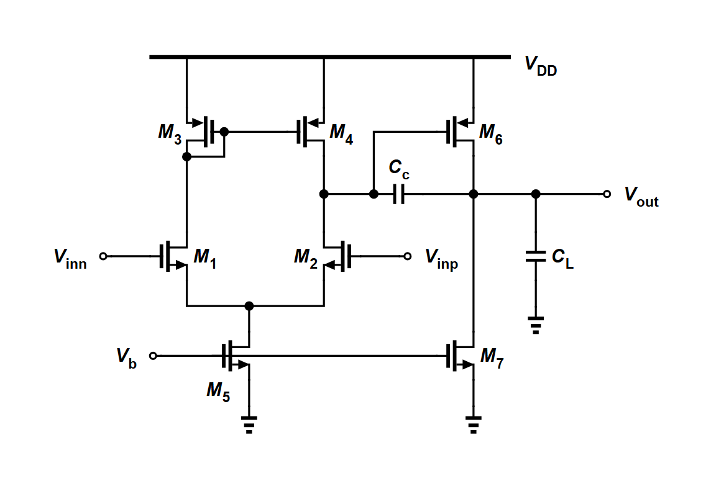
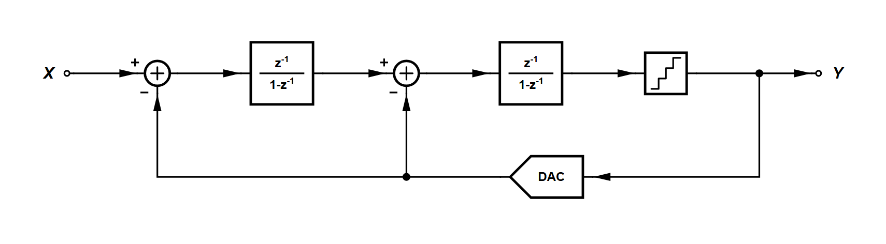
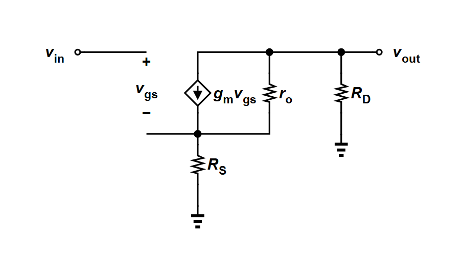

# acplan — 人（或模型）擺位置，Analog Canvas 的編輯器走線

這個資料夾是另一條畫電路圖的路線：畫圖的人只決定**每顆元件放在哪一欄、哪一列、閘極朝哪邊**，
走線、接點、匯出 `.icproj.json` 交給 Analog Canvas 上游提供的**本機 headless 編輯器**。
產物用編輯器自己的引擎產生，所以在網站上按 Import 就能開。

適用：沒有參照圖、要自己決定怎麼擺的圖。電晶體級與運放級的課本電路（差動對、電流鏡、疊接、比較器、邏輯閘、運放回授電路），
訊號方塊圖（回授系統、PLL 線性模型、ΔΣ 調變器、收發機訊號鏈；箭頭自動加，見 `SOP.md` §6a），
以及小訊號等效電路（菱形受控源、g_m·v_gs、「+ v_gs −」，見 `SOP.md` §6b）。
有參照圖要照著畫的、剖面圖、波形示意，請用 repo 根目錄 `SOP.md` 的產生器路線。







## 需要的東西

| 工具 | 用途 |
|---|---|
| Python 3.8+ | 跑 `acplan.py` |
| Node.js 18+ | 跑上游的 headless 編輯器 |
| `pip install playwright`＋`playwright install chromium` | 把 SVG 轉成 PNG |
| 上游的兩個檔（見下） | 編輯器本體，**本 repo 不附** |

### 取得上游的 headless 工具

到 Analog Canvas 上游（[cascode-ai/analog-canvas](https://github.com/cascode-ai/analog-canvas)）的 GitHub Releases 下載這兩個檔，放進本資料夾：

- `analog-canvas-headless-0.17.107.mjs`
- `analog-canvas-mcp-server-0.17.107.tgz`

對一下 `SHA256SUMS.txt`，再解開：

```bash
mkdir -p pkg && tar -xzf analog-canvas-mcp-server-0.17.107.tgz -C pkg
```

它們是上游的資產，授權以上游為準；本 repo 只放自己寫的程式。版本不同時改 `acsession.py` 開頭的兩個路徑，
並照 `SOP.md` §12 重跑全部範例。

## 用法

```bash
python plans_py/two-stage-miller.py          # 出一張：out/two-stage-miller.png、.icproj.json
python runbatch.py 5T-OTA gilbert-cell       # 出多張，拼成 out/_batch.png
python test_check.py                         # 慣例檢查器的自測
```

每張圖是一份很短的 Python（`plans_py/`），例如兩級 Miller 運放：

```python
p = Plan("two-stage-miller", "../toolkit/decks/new/two-stage-miller.cir")
p.pair("M3", "M4", cols=(180, 290), y=110, gates="in")     # 電流鏡：閘極相對
p.pair("M1", "M2", cols=(180, 290), y=210, gates="out")    # 差動對：閘極朝外
p.mos("M5", 230, 290); p.mos("M6", 410, 110); p.mos("M7", 410, 290)
p.two("CC", 350, 160, horizontal=True); p.two("CL", 460, 210)
p.port_pin("inp", "M1", "G"); p.port_pin("inn", "M2", "G"); p.port_pin("vb", "M5", "G", lead=40)
p.port("out", 510, 160, "R"); p.gate_through("M5", "M7")
p.hline("tail", 250); p.hline("out", 160); p.rail(50)
p.draw()
```

`p.draw()` 會印 `CHECK: PASS` 或逐條列出問題。檢查包含三件事：

1. 編輯器自己的診斷（0 錯誤、0 警告）。
2. 匯出的 netlist 與輸入的 deck 等價。
3. 慣例：差動對同列且閘極朝外、尾電流源置中、共用閘極的一對相對、列距、埠的引線長度、整體鬆緊。

`CHECK: PASS` 不代表好看，交付前還是要打開 PNG 看（`SOP.md` §8）。

## 內容

- `acplan.py`：位置表產生器＋慣例檢查器。`acoverlap.py`：出圖後自動檢查字有沒有壓到字或線。`acdraw.py`：照位置表呼叫編輯器。`acsession.py`：跟 headless 編輯器的連線。
- `plans_py/`：74 張範例（其中 8 張是訊號方塊圖、6 張是小訊號等效電路），新圖先找最像的照抄。`examples/`：這些範例的 PNG 與 `.icproj.json`。
- `SOP.md`：完整做法，包含走線被拒絕時的修法表、交付前的看圖清單、上游改版時的處理程序。
- deck 在 `../toolkit/decks/`。

## 這套做法驗過什麼

`SOP.md` 寫完後，請另一個沒看過這些電路的模型只靠 SOP 與範例畫 10 張保留的電路
（folded cascode、StrongARM latch、交叉耦合 LC 振盪器、儀表放大器等），10 張都通過檢查，每張跑 1～3 次；
其中 1 張因為檢查器少一條規則而畫得不像課本，補規則後重畫。過程中回報的缺口都補回 SOP 了。
方塊圖的部分用同樣的方式測了 3 張（二階 ΔΣ、帶前饋的回授、PLL 加相位雜訊），3 張都通過，每張跑 1～2 次；回報的 4 處缺口也補回 SOP 了。

已知限制：偶爾會遇到工作區檔案暫時被鎖（`WORKSPACE_SAVE_FAILED`），原樣重跑即可，`runbatch.py` 會自動重跑一次。
